# Hi, I'm Nihal Maskey 👋

## Senior Software Engineer | Lead Engineer

📍 Kathmandu, Nepal

Building scalable, secure, and efficient systems with 5+ years of experience in full-stack development and healthcare technology.

---

## 🚀 Current Role

**Lead Engineer** at [Leapfrog Technology](https://www.lftechnology.com/) / [Trayt Health](https://trayt.health/)
*Present*

- Architecting scalable healthcare solutions
- Leading engineering teams across US, Australia, and Nepal
- AWS infrastructure design for HIPAA/SOC2 compliance

---

## 📈 Contributions

<picture>
  <source media="(prefers-color-scheme: dark)" srcset="assets/city-dark.svg">
  
</picture>

---

## 💻 Tech Stack

**Languages & Frameworks:**

**Cloud & DevOps:**

**Databases:**

---

## 📫 Get In Touch

- 💼 [LinkedIn](https://www.linkedin.com/in/maskeynihal)
- 🐦 [X](https://x.com/nihalmaskey)
- 📧 [contact@nihal.com.np](mailto:contact@nihal.com.np)
- 🌐 [nihal.com.np](https://nihal.com.np)

---

*Building robust solutions for healthcare and beyond.*
